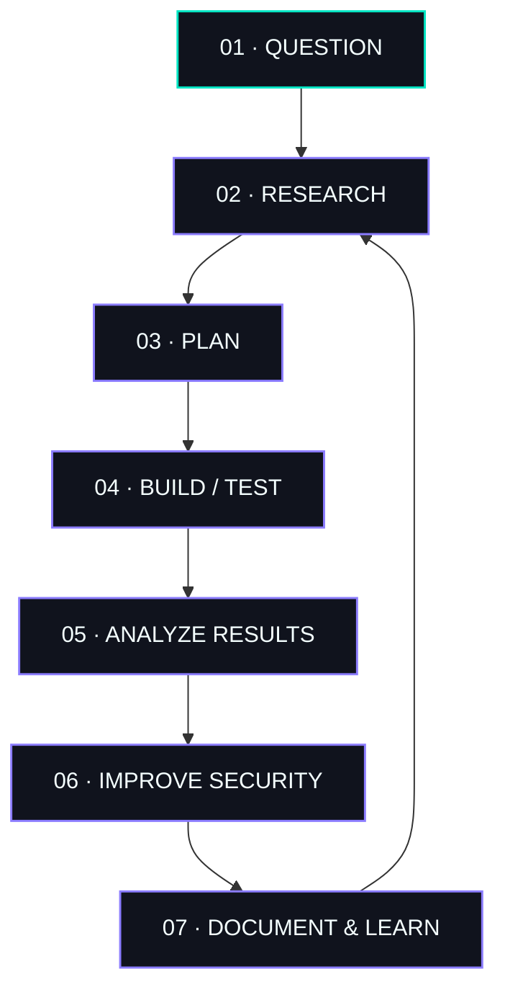

<div align="center">

<a href="https://github.com/alfin014">
  
</a>


<br/>


<br/><br/>

<a href="https://github.com/alfin014"></a>
<a href="https://finzdev.my.id"></a>
<a href="https://instagram.com/alfi.nzs"></a>

<br/><br/>


</div>

---

<div align="center">

### `01 // OPERATOR PROFILE`

# `V1N55X404`

**Cyber Security Enthusiast · Frontend Developer · Technology Explorer**

*Curiosity is the entry point. Evidence is the standard.*

<br/>

> **Understand the system. Build with intent. Secure by design.**

</div>

<table>
<tr>
<td width="58%" valign="top">

### `ABOUT.ME`

I'm a technology enthusiast from **Indonesia**, interested in understanding how software, networks, and systems work beneath the surface.

I enjoy building practical web projects, experimenting with Linux and Termux, and learning cybersecurity through research, controlled testing, and hands-on practice.

**Current areas of interest**
- Application and web security
- Networking and infrastructure
- Linux, CLI, and Termux
- OSINT and reconnaissance concepts
- Frontend and backend development
- Secure coding and system analysis

</td>
<td width="42%" valign="top">

### `OPERATOR_CARD`

```text
┌──────────────────────────────┐
│       BLACKBOX / PROFILE     │
├──────────────────────────────┤
│ HANDLE   : V1N55X404         │
│ ROLE     : LEARNER / BUILDER │
│ DOMAIN   : SECURITY + WEB    │
│ SYSTEM   : LINUX / TERMUX    │
│ BASE     : INDONESIA         │
│ STATUS   : ACTIVE LEARNING   │
├──────────────────────────────┤
│ ETHICS   : AUTHORIZED ONLY   │
└──────────────────────────────┘
```

</td>
</tr>
</table>

---

<div align="center">

### `02 // TECHNICAL DOMAINS`

*Areas I'm exploring, practicing, and building in.*

</div>

<table>
<tr>
<td width="25%" align="center" valign="top">

### `01`


**WEB SECURITY**

`HTTP / HTTPS`  
`OWASP concepts`  
`Web testing`  
`Secure coding`

</td>
<td width="25%" align="center" valign="top">

### `02`


**NETWORKING**

`TCP / IP`  
`Ports & protocols`  
`Traffic analysis`  
`Infrastructure`

</td>
<td width="25%" align="center" valign="top">

### `03`


**SYSTEMS**

`Linux`  
`Kali Linux`  
`Termux`  
`Command line`

</td>
<td width="25%" align="center" valign="top">

### `04`


**RESEARCH**

`OSINT concepts`  
`Enumeration`  
`Investigation`  
`Analysis`

</td>
</tr>
</table>

---

<div align="center">

### `03 // STACK & TOOLKIT`

**LANGUAGES & DEVELOPMENT**


<br/><br/>

**ENVIRONMENT & WORKFLOW**


<br/><br/>


</div>

---

<div align="center">

### `04 // ENGINEERING WORKFLOW`

**A repeatable process beats random guessing.**



</div>

---

<div align="center">

### `05 // SELECTED PROJECTS`

*Practical builds, not just ideas in a notes app.*

</div>

<table>
<tr>
<td width="50%" valign="top">

<div align="center">


## YADIKA LIBRARY

**Library Management System**


</div>

A web-based library system designed to manage book records, members, borrowing, returns, and administration.

**Focus**
- Book and member management
- Borrowing and return workflow
- Database-backed application

<div align="center">

<a href="https://github.com/alfin014/perpustakaan-yadika"></a>

</div>

</td>
<td width="50%" valign="top">

<div align="center">


## YADIKA CYBER ACADEMY

**Cybersecurity Learning Platform**


</div>

A learning platform concept focused on cybersecurity fundamentals, Linux, networking, OSINT concepts, and practical challenges.

**Focus**
- Structured learning materials
- Hands-on challenge concepts
- Security and system fundamentals

<div align="center">

<a href="https://github.com/alfin014/yadika-cyber-academy"></a>

</div>

</td>
</tr>
</table>

---

<div align="center">

### `06 // LEARNING LOG`

| DOMAIN | CURRENT DIRECTION |
|:--|:--|
| **Web Security** | Understanding common vulnerabilities and safer testing |
| **Linux / Termux** | Command-line fluency and system workflows |
| **Frontend** | Responsive interfaces and better user experience |
| **Networking** | Protocols, ports, and traffic fundamentals |
| **Python** | Scripting and automation fundamentals |
| **OSINT** | Research methods and information analysis |

<br/>

`PROGRESS > PERFECTION`

*Skills grow through practice, documentation, and honest review.*

</div>

---

<div align="center">

### `07 // GITHUB TELEMETRY`


<br/><br/>


<br/><br/>


</div>

> **Telemetry note:** GitHub statistics and third-party widgets may take time to load, and their availability depends on the external services.

---

<div align="center">

### `08 // TERMINAL SESSION`

```text
┌──(V1N55X404㉿BLACKBOX)-[~/core]
│
├─$ whoami
│  V1N55X404
│
├─$ inspect --domains
│  [ONLINE] SECURITY
│  [ONLINE] SYSTEMS
│  [ONLINE] DEVELOPMENT
│  [ACTIVE] RESEARCH
│
├─$ cat principles.txt
│  Understand before assuming.
│  Test before trusting.
│  Document what you learn.
│  Secure what you build.
│
├─$ systemctl status curiosity
│  ● curiosity.service
│    Active: running
│    Restart: always
│
└─$ _
```

<br/>


# `LEARN. BUILD. SECURE.`

**One system at a time. One lesson at a time.**

<br/>

<a href="https://github.com/alfin014"></a>
<a href="https://portofolio-diriku.netlify.app/"></a>
<a href="https://instagram.com/alfi.nzs"></a>
<a href="mailto:alfinzafitra@gmail.com"></a>

<br/><br/>


<sub>`BLACKBOX NODE` · `V1N55X404` · `INDONESIA` · `2026`</sub>

</div>
